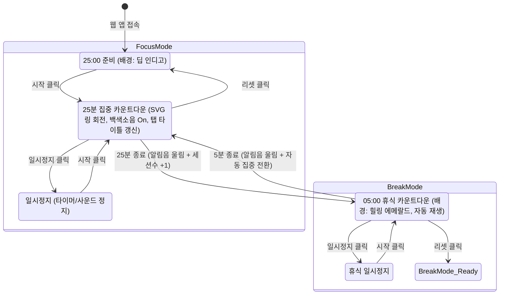

# 🍅 포모도로 타이머 웹 앱 프로젝트 개요 및 기능명세서

---

## 1. 프로젝트 개요 (Project Overview)

### 1.1 프로젝트 명
- **FocusFlow (가칭: 포모도로 스마트 타이머)**

### 1.2 프로젝트 목적
- 효율적인 시간 관리 기법인 **포모도로 기법(25분 집중 + 5분 휴식)**을 극대화할 수 있는 감각적이고 몰입감 높은 웹 애플리케이션 구축.
- 단순 타이머를 넘어 **시각적 진행률(SVG 링), 청각적 집중 환경(백색소음), 상태별 인터랙티브 무드 전환(테마 변화)**을 통해 사용자가 몰입을 유지하고 적절한 휴식을 취할 수 있도록 유도.

### 1.3 핵심 기술 스택
- **구조 (Markup)**: Semantic HTML5
- **스타일링 (Styling)**: Vanilla CSS3
  - 모던 글래스모피즘(Glassmorphism) 및 뉴모피즘 디테일
  - CSS Custom Properties(변수) 기반의 부드러운 테마 전환 (집중 ↔ 휴식)
  - SVG 원형 게이지 애니메이션
- **로직 (Scripting)**: Vanilla JavaScript (ES6+)
  - 정밀 오프셋 타이머 (타이머 오차 보정 `requestAnimationFrame` 또는 `Date.now()` 드리프트 방지)
  - Web Audio API 및 HTML5 Audio를 활용한 멀티 트랙 백색소음 재생 및 알림음 시스템
  - LocalStorage를 활용한 세션 기록 보존

---

## 2. 화면 구조 및 UI/UX 설계 (Layout & Design System)

### 2.1 디자인 컨셉 & 무드
| 구분 | 집중 모드 (Focus State) | 휴식 모드 (Break State) |
| :--- | :--- | :--- |
| **핵심 감성** | 깊은 몰입감, 차분함, 긴장 완화 | 편안한 이완, 회복, 상쾌함 |
| **메인 배경** | 딥 나이트 인디고 & 바이올렛 그라디언트 | 소프트 세이지 & 에메랄드 틸 그라디언트 |
| **포인트 액센트** | 로즈 코랄 / 네온 앰버 | 산뜻한 민트 / 에메랄드 그린 |
| **배경 트랜지션** | CSS `transition: background 1.2s cubic-bezier(0.4, 0, 0.2, 1)` 적용 |

### 2.2 화면 구성 와이어프레임 구조
```
+--------------------------------------------------------+
|  [Logo / Title] FocusFlow         [Session Stats] 🍅 x3 |
+--------------------------------------------------------+
|                                                        |
|                     [Mode Badge]                       |
|                   "🎯 깊은 집중 시간"                    |
|                                                        |
|                 /--------------------\                 |
|                /   ==============     \                |
|               |   /              \     |               |
|               |  |     24:58      |    |  <- SVG Ring  |
|               |   \              /     |               |
|                \   ==============     /                |
|                 \--------------------/                 |
|                                                        |
|            [ ▶ 시작 ]  [ ❚❚ 일시정지 ]  [ ↺ 리셋 ]        |
|                                                        |
+--------------------------------------------------------+
|  🎧 백색소음 사운드스케이프                               |
|  [ 🌊 파도 ]  [ 🌧️ 빗소리 ]  [ 🐦 새소리 ]  [ 🔇 음소거 ] |
|  Volume: [──────●────────────] 65%                      |
+--------------------------------------------------------+
```

---

## 3. 기능 명세서 (Functional Specification)

### 3.1 타이머 코어 및 자동 전환 시스템 (Timer Engine)
- **기본 사이클**: 
  - 집중 세션: **25분 (1,500초)**
  - 휴식 세션: **5분 (300초)**
- **자동 전환 메커니즘**:
  - 25분 집중 시간이 00:00에 도달하면 즉시 '종료 알림음' 재생 후 **자동으로 5분 휴식 모드로 전환 및 카운트다운 시작**.
  - 5분 휴식 시간이 00:00에 도달하면 '종료 알림음' 재생 후 **자동으로 25분 집중 모드로 전환**.
- **드리프트 방지 정밀 카운트**:
  - 단순 `setInterval` 지연 누적을 방지하기 위해 시작 시점의 타임스탬프(`Date.now()`) 기반으로 잔여 시간을 실시간 계산.

### 3.2 제어 컨트롤 (Controls)
- **시작 (Start)**:
  - 타이머 가동. 활성화 시 '시작' 버튼 비활성화 또는 시각적 활성 상태 표시.
  - 선택된 백색소음이 있는 경우 타이머 동작과 함께 부드럽게 페이드인 재생.
- **일시정지 (Pause)**:
  - 현재 시점에서 잔여 시간을 일시 동결.
  - 백색소음 일시정지.
- **초기화 (Reset)**:
  - 현재 활성화된 모드(집중 or 휴식)의 기준 시간(25분 or 5분)으로 즉시 원복.
  - 원형 프로그레스 링 100% 상태로 리셋.
- **UI 애니메이션**:
  - 모든 버튼은 넉넉한 둥근 모서리(`border-radius: 9999px` 필 스타일 또는 `16px`).
  - 마우스 오버(Hover) 시 미세한 상단 부유 효과(`translateY(-2px)`), 발광 글로우(`box-shadow`) 및 부드러운 스케일 모션.

### 3.3 중앙 비주얼 디스플레이 & 원형 프로그레스 링 (Circular Progress Ring)
- **중앙 디지털 시계**:
  - `MM:SS` 형식으로 고대비 대형 폰트(가변/모노스페이스 패밀리) 적용.
- **SVG 프로그레스 링**:
  - SVG `<circle>` 엘리먼트의 `stroke-dasharray`와 `stroke-dashoffset`을 이용한 실시간 진행률 렌더링.
  - 경과된 시간 비율에 따라 시계 방향으로 자연스럽게 차오르거나 줄어드는 부드러운 애니메이션 적용.
  - 집중 모드일 때는 에너제틱한 그라디언트 링, 휴식 모드일 때는 릴렉싱 틸/그린 그라디언트 링 적용.

### 3.4 브라우저 탭 실시간 동기화 (Tab Title Sync)
- **브라우저 제목 업데이트**:
  - 포커스가 다른 탭에 있더라도 잔여 시간을 확인할 수 있도록 `document.title` 동적 업데이트.
  - 예시: 
    - 집중 중: `(24:59) 🎯 집중 시간 - FocusFlow`
    - 휴식 중: `(04:45) ☕ 휴식 시간 - FocusFlow`
    - 정지 상태: `(일시정지) FocusFlow`

### 3.5 오디오 & 백색소음 사운드스케이프 (Audio System)
- **백색소음 선택 (3종)**:
  1. **파도 (Ocean Waves)**: 깊고 규칙적인 해변의 파도 소리
  2. **비 (Gentle Rain)**: 창가를 두드리는 차분한 빗소리
  3. **새 소리 (Forest Birds)**: 숲속의 맑고 평화로운 새 지저귐
- **재생 제어 & 믹서**:
  - 사운드 버튼 토글 (하나를 켜면 단일 재생, 또는 무음 선택 가능).
  - 슬라이더형 음량 조절 (0% ~ 100%).
  - 원클릭 음소거(Mute/Unmute) 버튼 및 현재 음소거 상태 아이콘 표시(🔊 / 🔇).
- **종료 알림음 (Alarm Chime)**:
  - 집중 25분 종료 및 휴식 5분 종료 시 청명하고 기분 좋은 차임벨 알림음 자동 1회 출력.
  - 외부 음원 로딩 실패 시를 대비하여 Web Audio API 오실레이터(Oscillator) 기반 내장 멜로디 차임 듀얼 폴백 구현.

### 3.6 세션 카운터 (Session Counter)
- **기록 로직**:
  - 25분의 집중 세션을 온전히 완주했을 때마다 **카운터 +1 증가**.
  - 완료된 세션은 상단 또는 하단에 시각적 뱃지(예: 🍅 아이콘 또는 도트 인디케이터)로 나열.
- **영속성 (Persistence)**:
  - `localStorage`를 연동하여 브라우저 새로고침이나 탭을 닫았다 다시 열어도 오늘의 달성 횟수 유지.
  - 필요 시 카운트를 0으로 되돌릴 수 있는 '카운터 리셋' 편의 기능 제공.

---

## 4. 사용자 인터랙션 및 상태 전이도 (State Transition Flow)



---

## 5. 단계별 개발 및 구현 계획 (Roadmap)

1. **Step 1: UI 마크업 및 디자인 토큰 구축 (`index.html`, `style.css`)**
   - 글래스모피즘 컨테이너, SVG 프로그레스 링 마크업, 둥근 모서리 및 호버 인터랙션 구현.
   - 집중 모드(`theme-focus`)와 휴식 모드(`theme-break`) CSS 테마 변수 및 배경 전환 트랜지션 정의.
2. **Step 2: 타이머 코어 로직 & SVG 게이지 연동 (`app.js`)**
   - 25분/5분 타임스탬프 기반 타이머, 시작/일시정지/리셋 컨트롤러.
   - 남은 시간에 맞춰 SVG `stroke-dashoffset` 및 브라우저 `document.title` 동기화.
3. **Step 3: 오디오 엔진 구축 (백색소음 & 알림음)**
   - 파도/비/새소리 오디오 루프 스트리밍 또는 고품질 Web Audio 소스 로드.
   - 볼륨 조절, 음소거 토글, 세션 종료 시 차임벨 알림음 연동.
4. **Step 4: 세션 카운터 및 데이터 영속화**
   - 집중 세션 완주 감지, 카운터 증가 및 `localStorage` 동기화.
5. **Step 5: 크로스 브라우징 및 UX 폴리싱**
   - 모바일/데스크톱 반응형 뷰포트 최적화, 오디오 자동재생 브라우저 정책(User Interaction) 대응.
